

# Gestionnaire Finance

**Tes finances personnelles, claires et 100 % sur ton ordinateur.**

Budget et reste à vivre · Prévisions jusqu'à la paie · Patrimoine · Assistant IA local

[**Télécharger pour Windows**](https://github.com/Nalro-ia/gestionnaire-finance-releases/releases/latest) · [Voir la vidéo](https://github.com/Nalro-ia/gestionnaire-finance-releases/raw/main/assets/demo.mp4)

 

<a href="https://github.com/Nalro-ia/gestionnaire-finance-releases/raw/main/assets/demo.mp4">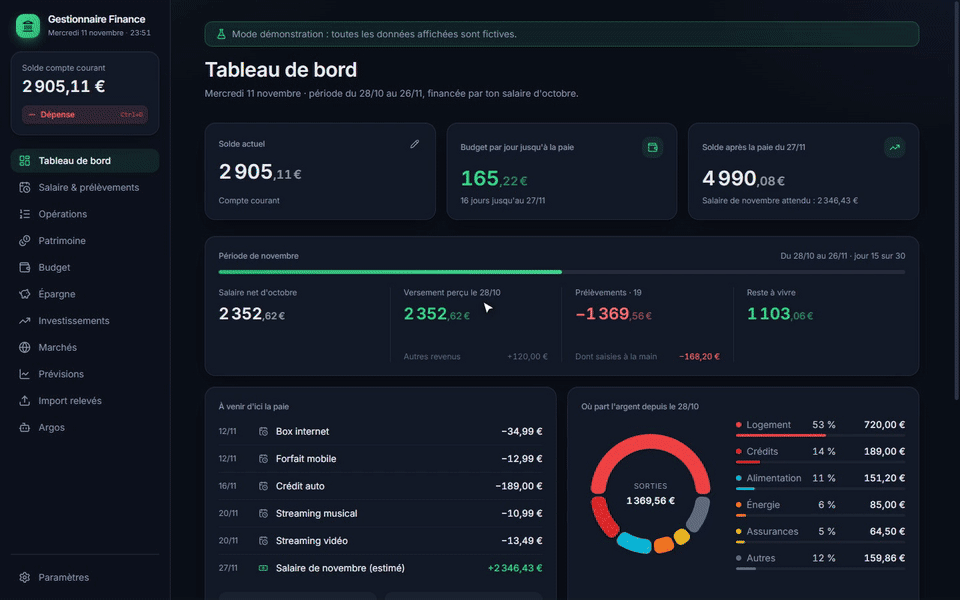</a>

Démonstration en accéléré : tableau de bord, patrimoine, budget, prélèvements du mois, saisie d'une dépense, marchés, prévisions, passage au thème clair. Toutes les données sont fictives.

---

## Pourquoi Gestionnaire Finance

La plupart des applications de budget demandent un compte en ligne et l'accès à ta banque. Gestionnaire Finance fait l'inverse : **tout reste sur ton PC**, dans une base chiffrée que seul ton mot de passe ouvre. Pas d'abonnement à un agrégateur, pas de publicité, pas de revente de données.

Et il répond à la vraie question du quotidien : **combien puis-je encore dépenser d'ici la prochaine paie ?**

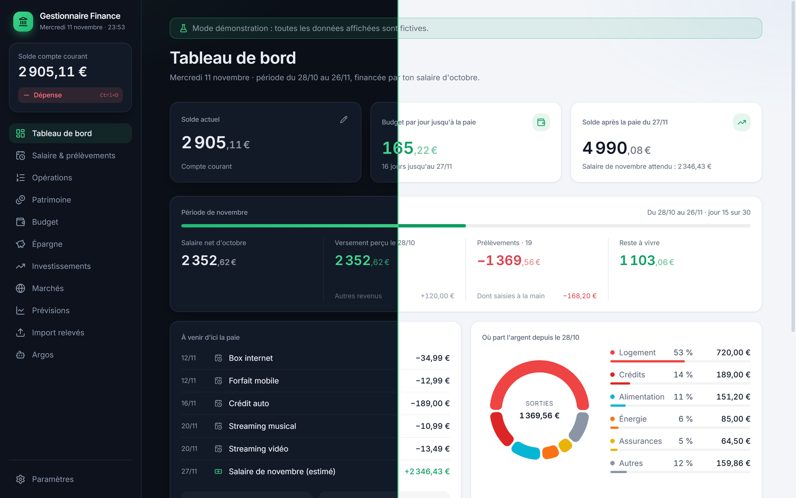
 Le tableau de bord, en thème sombre et en thème clair.

## Ce qu'il fait

| | |
|---|---|
| 🧭 **Tableau de bord** | Solde, budget par jour jusqu'à la paie, avancement de la période, reste à vivre, ce qui sort encore avant la paie, répartition des dépenses. |
| 💶 **Salaire** | Fiche de paie en PDF lue automatiquement, acompte, primes, 13e mois. Le jour de paie suit les week-ends et jours fériés. |
| 🔁 **Prélèvements et revenus récurrents** | Inscrits tout seuls au bon jour ouvré (calendrier bancaire français), montant ajustable mois par mois. |
| 🧾 **Opérations** | Saisie express d'une dépense (`Ctrl+D`), regroupement par jour, export CSV pour Excel. |
| 📥 **Import de relevés** | Fichiers OFX ou CSV de ta banque, doublons écartés, catégories proposées automatiquement. |
| 👛 **Budget et enveloppes** | Ce que le salaire couvre, ce qui reste, l'argent mis de côté pour les projets. |
| 🎯 **Épargne** | Livrets, fonds d'urgence et objectifs avec date cible et progression. |
| 📈 **Investissements et patrimoine** | Répartition de tes placements, évolution du patrimoine total relevée chaque jour. |
| 🌍 **Marchés** | Grands indices et cryptos avec graphiques, équivalent en euros au taux de la BCE. |
| 🔮 **Prévisions** | Le solde mois par mois sur 3 mois à 2 ans. |
| 🤖 **Argos, assistant IA local** | Répond sur tes chiffres en langage clair, avec un modèle qui tourne sur ton PC (Ollama). Rien ne part sur Internet. Argos explique, il ne conseille pas : ce n'est pas un conseiller en investissement. |
| 🌗 **Thème sombre ou clair** | Ou celui de Windows, au choix dans les paramètres. |

## Aperçu

<table>
<tr>
<td width="50%">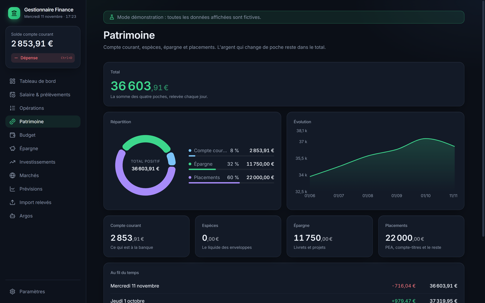 <b>Patrimoine</b> : répartition et évolution</td>
<td width="50%">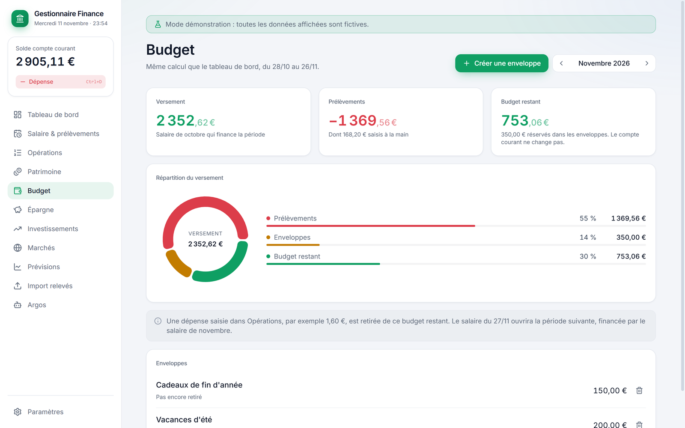 <b>Budget</b> : ce que couvre le salaire, ce qui reste</td>
</tr>
<tr>
<td>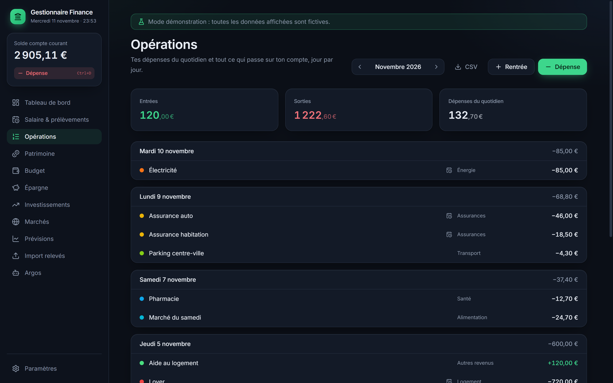 <b>Opérations</b> : jour par jour, catégories, export CSV</td>
<td>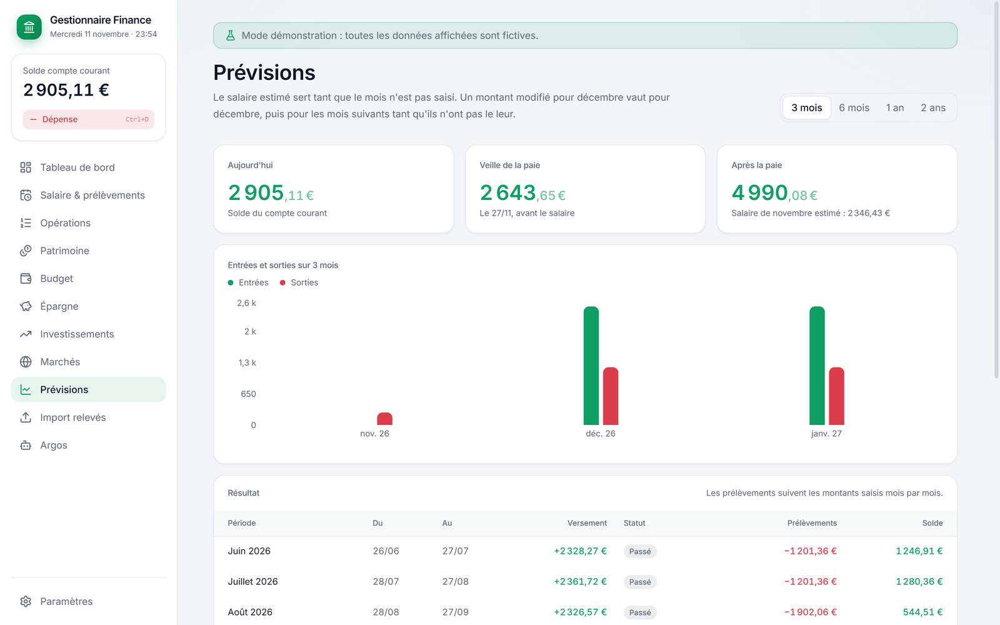 <b>Prévisions</b> : le solde des prochains mois</td>
</tr>
<tr>
<td>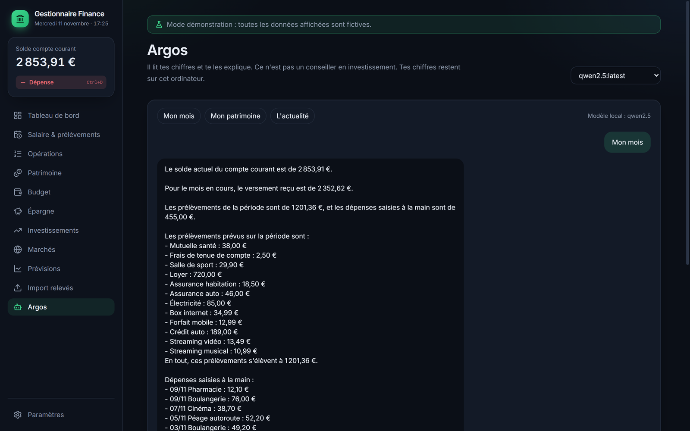 <b>Argos</b> : le point sur le mois, calculé sur tes chiffres</td>
<td>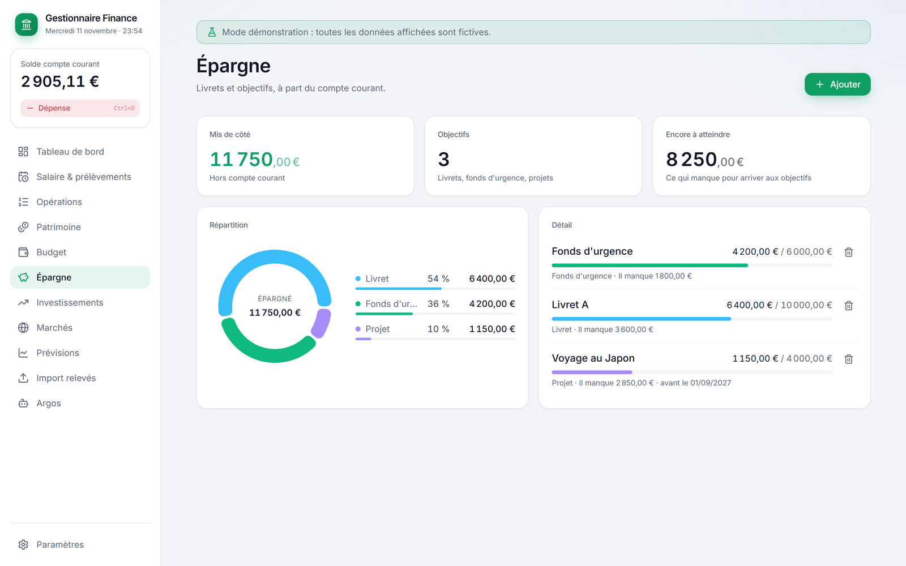 <b>Épargne</b> : objectifs et progression</td>
</tr>
<tr>
<td>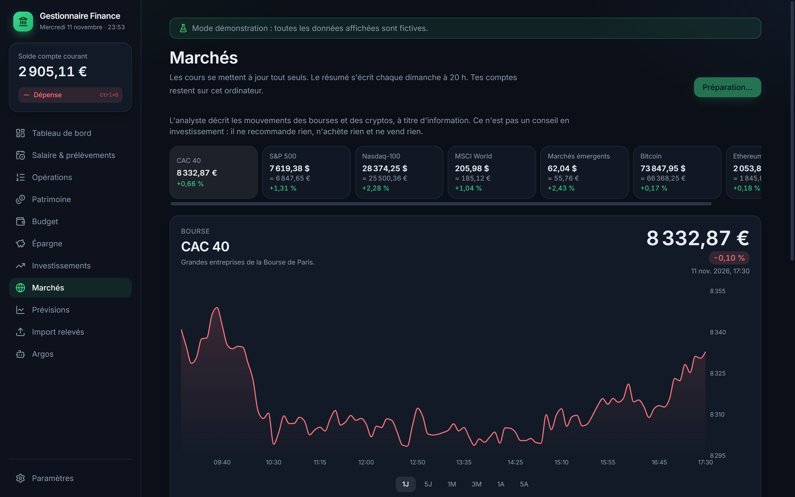 <b>Marchés</b> : indices, cryptos, équivalent en euros</td>
<td>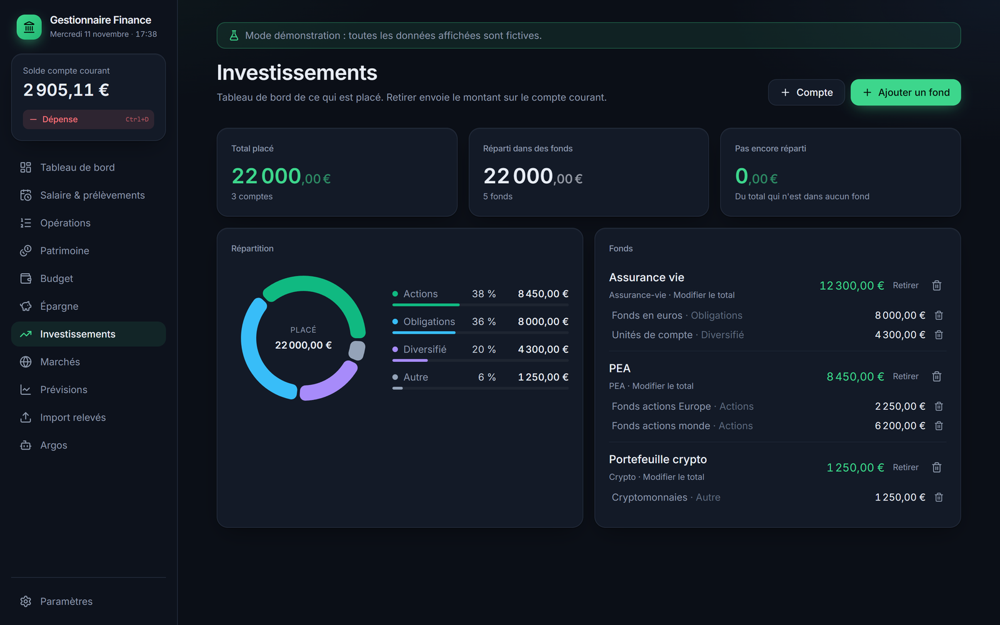 <b>Investissements</b> : répartition par support</td>
</tr>
<tr>
<td>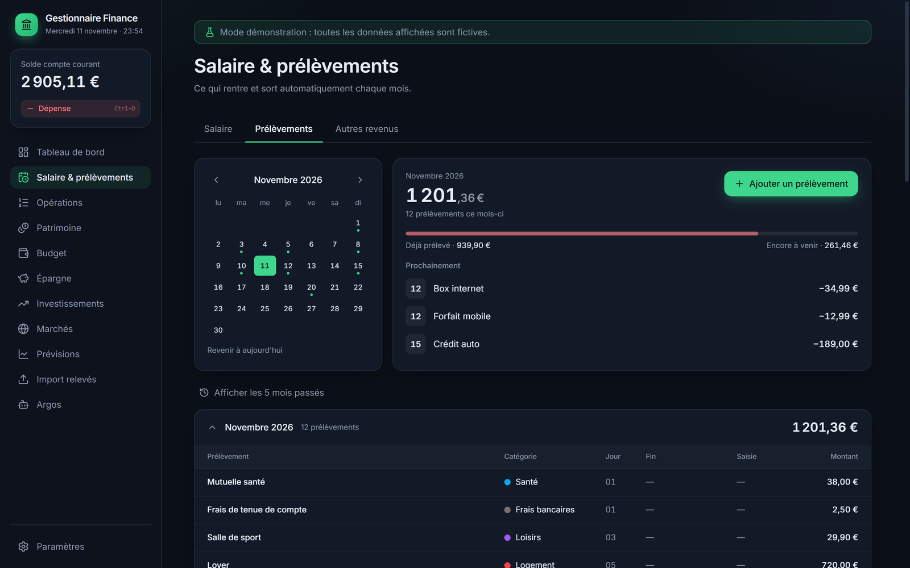 <b>Prélèvements</b> : le mois en un coup d'œil, prochaines échéances</td>
<td>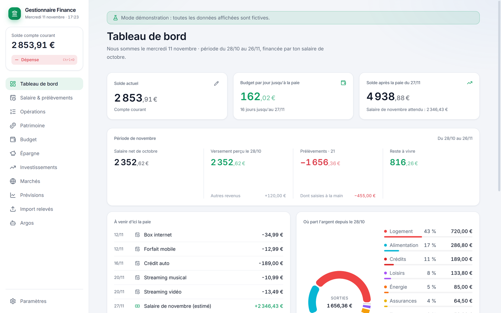 <b>Thème clair</b> : au choix, ou celui de Windows</td>
</tr>
</table>

## Tes données restent à toi

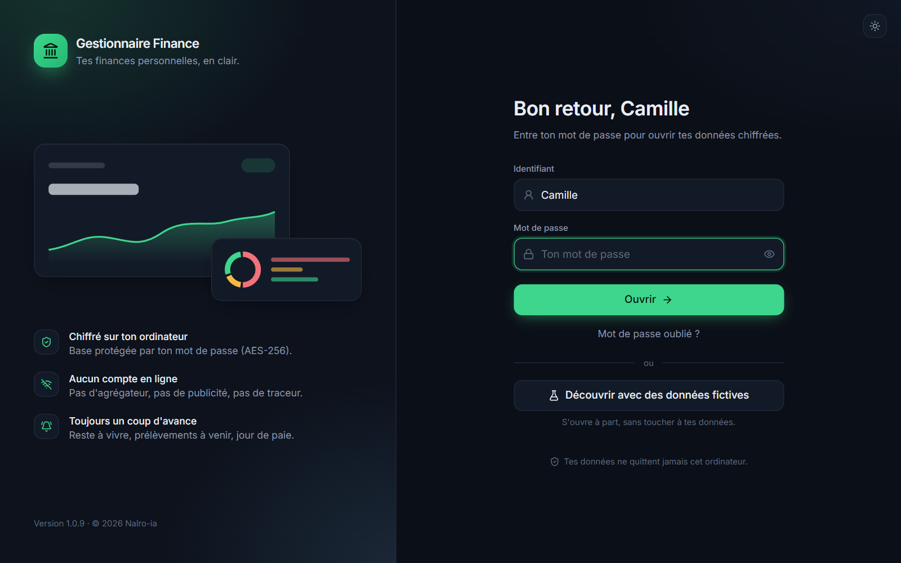
 L'écran de connexion : ton mot de passe ouvre la base chiffrée, rien ne part sur Internet.

- **Base chiffrée** (SQLCipher, clé AES-256) : sans ton mot de passe, le fichier est illisible.
- **Clé de récupération** donnée à la création, en cas d'oubli du mot de passe.
- **Copies de secours automatiques**, chiffrées elles aussi, avec recopie possible sur une clé USB.
- **Verrouillage automatique** après une heure sans utilisation.
- **Aucun compte en ligne, aucun traceur.** Les seules connexions servent aux cours des marchés, aux taux de change et aux mises à jour. Elles n'envoient aucun de tes chiffres (détail ci-dessous).

## Confidentialité

**L'auteur ne reçoit aucune donnée.** Pas de statistiques d'utilisation, pas de rapport de plantage, pas de compte : tes opérations, soldes, salaires et conversations avec Argos restent sur ton PC.

Le logiciel contacte seulement les services ci-dessous. C'est ton ordinateur qui les appelle directement. Comme pour toute visite d'un site web, ils voient ton adresse IP, mais **aucune de tes données financières ne leur est envoyée**.

| Service | Pourquoi | Ce qui est envoyé |
|---|---|---|
| [GitHub](https://github.com) | Rechercher et télécharger les mises à jour | Rien d'autre que la demande du fichier de version |
| [Yahoo Finance](https://finance.yahoo.com) | Cours des indices et cryptos de l'onglet Marchés | Une liste fixe d'indices, identique pour tout le monde, **jamais tes placements** |
| [Google News](https://news.google.com) | Titres de l'actualité économique pour le point marchés | Une recherche fixe, identique pour tout le monde |
| [Frankfurter](https://frankfurter.dev) | Taux de change de la BCE | La liste des devises |
| [Ollama](https://ollama.com) | Installer l'IA locale et ses modèles, si tu choisis d'activer Argos | Rien d'autre que le téléchargement |

Ces services appliquent leurs propres règles de confidentialité. Si tu n'ouvres pas l'onglet Marchés et n'installes pas Argos, seule la recherche de mise à jour a lieu.

## Essayer avant de saisir tes chiffres

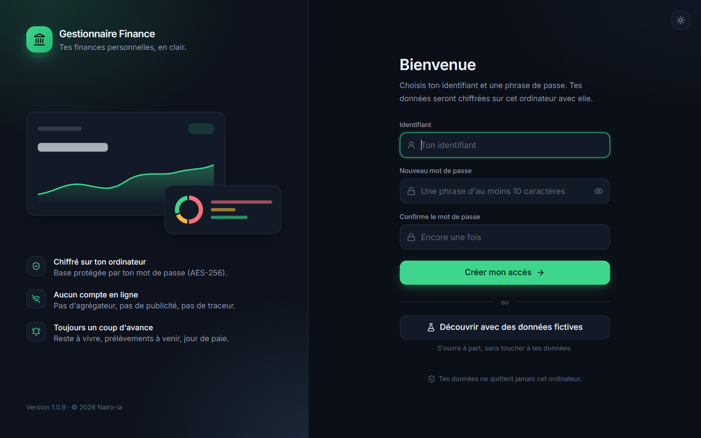
 Dès le premier lancement : crée ton accès, ou découvre d'abord le logiciel avec des données fictives.

Pas envie de tout remplir pour voir à quoi ça ressemble ? Clique sur **Découvrir avec des données fictives** sur l'écran d'accueil.

- La démonstration s'ouvre **dans une fenêtre à part**, avec un salaire, des prélèvements, une épargne et des placements inventés.
- Les dates suivent **le mois en cours**, donc tout est vivant : avancement de la période, prochaines échéances, jour de paie.
- **Tes propres données ne sont jamais ouvertes.** Un bandeau rappelle que tout est fictif, et **Quitter la démonstration** referme la fenêtre.

## Installer

1. Télécharge `Gestionnaire-Finance_<version>_x64-setup.exe` dans la [**dernière version**](https://github.com/Nalro-ia/gestionnaire-finance-releases/releases/latest).
2. Lance-le. Si Windows affiche « Windows a protégé votre ordinateur », clique sur **Informations complémentaires**, puis **Exécuter quand même**. L'installeur n'a pas encore de certificat de signature payant.
3. Choisis ton identifiant et ton mot de passe, puis note la clé de récupération. Tu peux aussi commencer par **Découvrir avec des données fictives**.

Les **mises à jour arrivent ensuite automatiquement** dans le logiciel, avec une signature vérifiée.

**Configuration :** Windows 10 ou 11, 64 bits. Argos est facultatif : au premier lancement, le logiciel propose d'installer l'IA locale et choisit un modèle adapté à ton PC.

## Un avis, un problème ?

Écris-le dans les [**Issues**](https://github.com/Nalro-ia/gestionnaire-finance-releases/issues/new/choose) de ce dépôt (un compte GitHub gratuit suffit). Toute idée d'amélioration est la bienvenue.

> [!WARNING]
> Les Issues sont **publiques** : tout le monde peut les lire. N'y mets **jamais de vrais montants, relevés, noms ou numéros de compte**, ni de capture de tes vraies données. Pour montrer un problème en image, masque d'abord les chiffres et les noms.

---

Captures et vidéo réalisées avec le mode démonstration du logiciel : toutes les données affichées sont fictives. 
Utilisation soumise à la licence acceptée à l'installation : usage personnel et familial, redistribution interdite sans l'accord de l'auteur. 
© 2026 Nalro-ia. Tous droits réservés.

